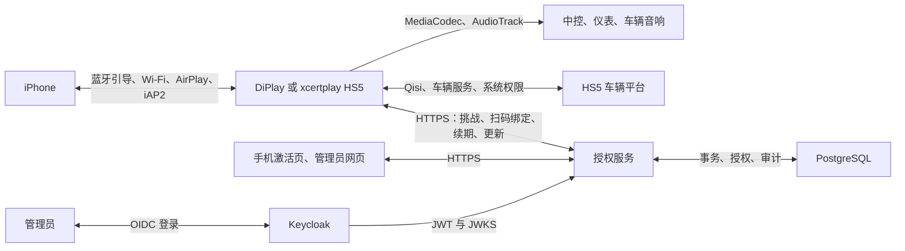

# 三套系统架构与联调验收

## 组件关系

服务端负责产品授权、设备管理、诊断接收和 APK 更新发布。音视频在 iPhone 与 Android 接收端之间传输。DiPlay 和 xcertplay 是两个独立客户端，不是一个工程的两个构建 flavor。

MFi／配件认证用于 iPhone 接受 CarPlay 接收端；软件购买授权用于 HUD、仪表地图和方向盘增强功能。二者使用不同接口和密钥，扫码购买不会生成 MFi 身份。基础 CarPlay 免费仍要求具备正常的连接、系统权限和配件认证条件。

| 项目 | DiPlay | xcertplay HS5 |
|---|---|---|
| mobile Release 包名 | `com.shihab.diplay` | `com.shilapi.xcertplay.hs5` |
| Debug 包名 | `com.shihab.diplay.hudtest` | 与其 Release 同包名 |
| mobile 版本 | 0.2.49-FAW-REFACTOR1 / 123 | 1.4.0-hs5.8 / 1408 |
| automotive | 旧声明 1.2.4-AUTH3 / 1204，独立入口 | 与 mobile 同版本及包名，作为替代入口构建 |
| Android 模块 | common、shared、mobile、automotive、home、maphost | common、shared、mobile、automotive |
| 配件身份输入 | 外部目录 `DIPLAY_AUTH_ASSETS_DIR/offline-mfi/` | 本地 `.private/local-auth/`，正常构建生成私有 assets |
| 产品授权／更新 | 已有完整客户端及后台实现 | 客户端已接入，新包名、签名 pin、正式渠道及迁移待联调 |
| 本次设备验证 | 仅复用明确标注的源码检查 | 引用既有 hs5.8 OPPO 记录；本次未连接车辆 |

## 服务配置与联调顺序

1. 在隔离环境构建服务端，准备 PostgreSQL、Keycloak 和 HTTPS。保留原数据库、签名密钥、设备记录和更新目录的备份；部署的具体持久卷和反向代理以实际 NAS 配置为准。Flyway 迁移到 V7，测试默认使用 H2。
2. 明确实际环境变量中的 `LICENSE_ALLOWED_APP_IDS`。源码默认名单不含 `com.shilapi.xcertplay.hs5`，接入时必须在保留已有包名的基础上增加它。Compose 生产覆盖文件会覆盖基础 Compose 默认值；必须检查最终生效配置。
3. 为每个正式包名准备对应 APK 发布证书指纹，配置服务端 `UPDATE_SIGNING_CERTIFICATES`。格式遵循服务端 README。发布证书、设备 Keystore 密钥、授权签名私钥三者用途不同。
4. 给 DiPlay 配置正式 HTTPS 地址、OIDC issuer、SPKI 公钥、APK 签名摘要及原 Android keystore；给 xcertplay 配置 `FAW_LICENSE_*` 和 `HS5_UPDATE_*` 六项信任输入。xcertplay 的实际配置方式见该包 `docs/HS5-PRODUCT-SERVICES.zh-CN.md`。
5. 先在测试服务完成挑战、扫码、领取、重启离线、联网续期、设备撤销／恢复和期限测试。永久购买不等于永久离线；新协议最多申请 90 天，旧客户端省略期限时仍按 7 天处理。
6. 对 xcertplay 单独制定旧用户迁移规则：新包名及独立 Keystore 会产生新设备身份。直接换包装可能额外占用设备／累计激活次数；管理员设备替换接口不能自动证明新旧安装属于同一用户。
7. 为 xcertplay 新包建立独立 stable 更新目录，验证清单签名、APK 哈希、实际包名、版本及证书。不能把 DiPlay APK 作为 xcertplay 更新推送。
8. 正式上线前核对版本递增与原签名连续性。DiPlay 当前源码仍声明 123；新发布需使用高于已发布值的版本号。xcertplay 现有 hs5.8 是调试签名测试版，正式签名无法直接覆盖不同签名的同包安装，迁移方式须先验收。

## 待完成的产品验收

| 范围 | 最低验收场景 | 当前边界 |
|---|---|---|
| 服务端 | 实际 PostgreSQL 迁移、Keycloak 管理员及角色、TLS、健康接口、数据持久化与恢复 | 本次执行 H2／网页／CLI；未部署或验证生产 |
| 授权 | 新设备、重复激活、额度耗尽、换设备、撤销、网络失败、离线到期、时钟回拨 | 自动化覆盖见包内结果；真实 xcertplay 新包联调待完成 |
| 更新 | 空渠道、坏签名、坏哈希、错误包、错误证书、旧版本、下载失败、安装后自动打开 | 真正覆盖升级和厂商安装权限待目标车机检查 |
| 连接 | 首装引导、首次配对、已配对重连、取消、熄火唤醒、连续断连重连 | 本次未运行车辆或 iPhone 连接 |
| 音视频 | 主屏／仪表、静置后操作、电话／Siri／导航打断与恢复、麦克风与回声 | OPPO 结果不代表 Intel HS5 音频和解码性能 |
| 车辆集成 | HUD、仪表地图、方向盘、倒车／E-CALL 让位、车辆权限与状态时效 | 必须在目标固件实车验证 |
| Ultra | Apple 规定的车辆数据、本地渲染、多屏及同步链路 | 尚未实现，不能作为已完成功能验收 |

记录测试固件、iPhone／iOS、APK SHA-256、签名摘要、操作步骤、预期、实际和日志时间。发现问题优先定位客户端、车辆平台或服务端的责任边界。保留有效离线票据的网络失败，与服务器明确撤销应有不同结果。
