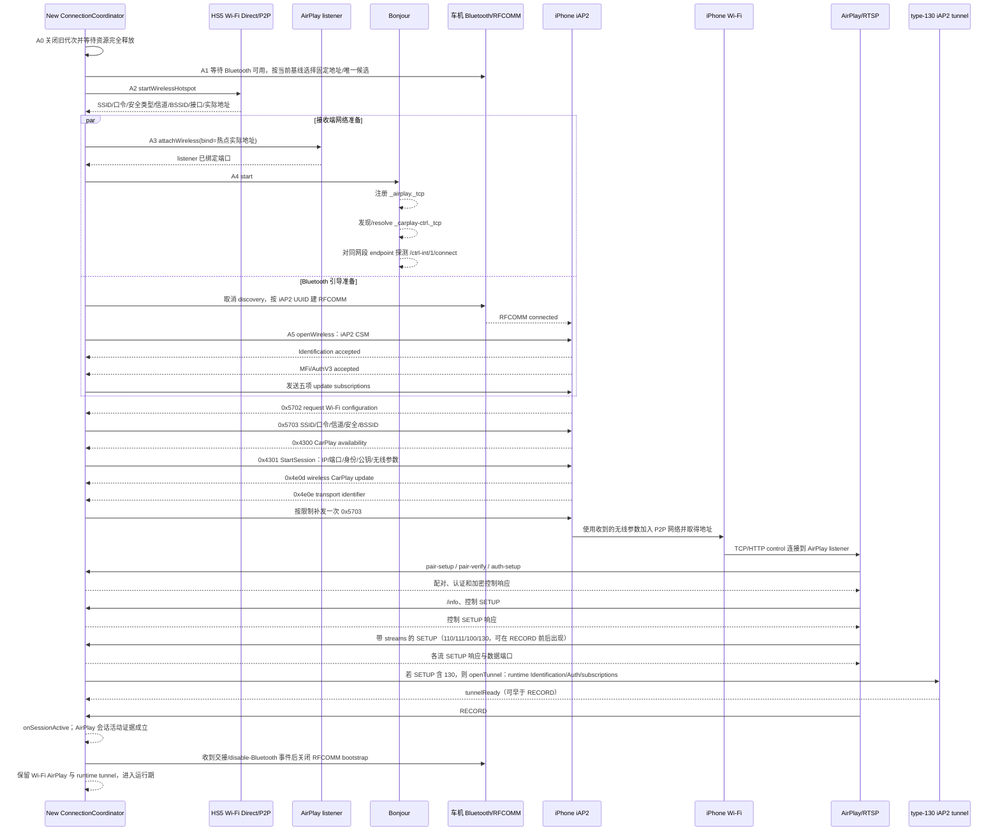

# FAWPlay 新仓库产品与技术规格说明

**状态**：Draft v1.4   
**日期**：2026-10-21（北京时间）  
**适用范围**：创建全新的 FAWPlay Android 9 系统级 CarPlay 接收服务源码仓库，面向 HS5、3212/3222 固件和车机系统启动生命周期。DiPlay、FAW-Play、xcertplay 及历史服务端只作为参考资料，不是本次修改对象，也不是新仓库的代码依赖。  
**实施原则**：先固定 Apple 功能覆盖、连接行为和证据，再在新仓库中分阶段实现；服务必须随车机系统启动、后台持续运行、快速连接并稳定恢复，每个阶段都能编译、回滚和单独验收。

## 1. 背景与证据边界

本次交付物是一个全新的源码仓库。现有工程只用于提取可验证的行为、协议交接、HS5 接口差异和测试线索：

| 参考资料 | 用途 | 参考入口 |
| --- | --- | --- |
| DiPlay / FAW-Play | 参考 CarPlay 接收、主屏/仪表/HUD、音视频、车辆状态和现有无线交接 | `源码/02-DiPlay-0.2.49-REFACTOR1-source-20261015/DiPlay/` |
| xcertplay HS5 | 参考另一套 CarPlay 接收实现及 HS5 差异 | `源码/03-xcertplay-1.4.0-hs5.8-source-20261015/xcertplay/` |
| 历史授权服务端 | 识别需要移除的业务授权依赖和发布边界 | `源码/01-server-1.0.0-source-20261015/server/authorization-server/` |

本规格依据仓库中的架构说明、全量审计、连接复查和 HS5 源码审查整理。它不把历史单测、一次冷启动成功或旧 APK 现场记录当作新仓库已通过；新的结论必须由新仓库的同一构建、同一手机、同一 HS5 固件回归证据支持。3212 与 3222 分别验收，不能用一个固件的结果代表另一个固件。

新仓库不继承 DiPlay 或 xcertplay 的 Gradle 边界、类层次、UI、状态机或历史兼容分支；模块、包结构和接口由本规格重新设计。参考工程中的协议字段、时序、车辆接口和性能数据必须重新核实后再实现，不能通过复制代码默认为正确。MFi/AuthV3 是 CarPlay 配件技术认证，不是用户购买授权，继续保留；产品购买授权、设备激活、离线票据和授权服务端请求全部移除。

## 2. Apple 官方公开流程校准

Apple 的公开资料能确认用户可见的准备和连接条件，但没有公开第三方接收端的完整 RFCOMM、iAP2、P2P、AirPlay 报文时序。下面两层必须分开：

### 2.1 Apple 官方明确的用户流程

根据 [Apple“Use CarPlay with your iPhone”](https://support.apple.com/en-us/108415) 和 [CarPlay 连接故障排查](https://support.apple.com/en-us/105109)：

1. 启动车辆，确保 iPhone 的 Siri 已开启。
2. 有线 CarPlay：将 iPhone 接入车辆的 CarPlay USB 端口。
3. 同时支持有线和无线的车辆：首次先使用 USB，iPhone 会提供以后无线连接的选项。
4. 仅支持无线的车辆：车辆处于无线或 Bluetooth 模式，按住方向盘语音按钮；iPhone 的 Bluetooth 和 Wi‑Fi 必须开启，CarPlay Wi‑Fi 网络的 Auto-Join 必须开启，再在 iPhone 的“设置 → 通用 → CarPlay”中选择车辆。
5. 如果 CarPlay 没有自动激活，Apple 建议在车辆显示屏上选择 CarPlay 图标；这一步属于车辆/iPhone 原生界面，不属于本应用页面。
6. 后续使用以车辆上电、iPhone 在场、Bluetooth/Wi‑Fi 条件满足和已建立的 CarPlay 关系为前提。Apple 的排障顺序也是先检查 Bluetooth、Wi‑Fi、CarPlay 网络 Auto-Join、Siri、限制项和重新配对。

### 2.2 Apple 官方没有公开的部分

Apple 的公开页面没有确认“只凭 Bluetooth 已连接就等于 CarPlay 目标已确定”，也没有公开接收端必须使用的内部阶段名称或固定超时。接收端实现可以观察 Bluetooth 连接作为候选入口，但仍必须通过技术认证、协议握手、无线网络和 CarPlay 会话事件确认成功。参考工程中的 RFCOMM/iAP2、Wi‑Fi Direct、Bonjour、AirPlay、type 110/111 等属于接收端实现事实或待实车验证项，不能写成 Apple 公开规范。

Apple 的车载系统演讲可以确认更高层的时序原则：WWDC17《Developing Wireless CarPlay Systems》要求车机启动时准备 Bluetooth、Wi‑Fi/access point、networking、Bonjour 和 communication plugin，等待 Bluetooth 与 access point fully operational 后再连接 Bluetooth iAP2；暂时不可达时先尝试 CarPlay Control API 的 fast reconnect，失败后才回退 Bluetooth reconnect。WWDC23《Optimize CarPlay for vehicle systems》要求短暂 data-link 断开时不要仅因此关闭仍可用的已认证 socket；WWDC19/WWDC23 也确认主屏、仪表/导航 UI 可以是多路视频，并且 Route Guidance 元数据是独立于视频的车辆输出。这些是本项目恢复策略和资源边界的官方依据，但仍不能推出本项目私有报文的完整字段或固定时限。

本项目不以 Apple 未公开的内容作为新仓库实现依据。参考工程已经形成一条可运行的接收端时序，这条时序作为本规格的“参考源码兼容基线快照”，而不是 Apple 官方规范或永久不可变的协议真理。新仓库必须保留协议和资源的因果不变量；具体调用顺序只有在 trace、故障注入和实车证据支持下才能调整。热点必须先提供真实网络参数，随后 AirPlay listener、Bonjour 和 RFCOMM/iAP2 按参考工程的依赖并行准备；只有收到无线控制参数后，手机入网和 AirPlay 会话才能继续。不能把 RFCOMM 提前到热点参数可用之前，也不能把 Bluetooth bootstrap 提前关闭。

Apple 的 [MFi 官方流程](https://mfi.apple.com/en/how-it-works.html)只公开了加入计划、取得技术规格与组件、开发、认证、量产四步；该页面明确列出 CarPlay、iAP2 和认证协处理器属于 MFi 技术范围。它不等于本产品的购买授权。

## 3. 新仓库目标

### 3.1 必须达到的目标

1. 在新仓库建立连接、会话、资源所有权和恢复决策的可追踪生命周期模型，避免引入旧工程中的回调污染、重复恢复和无限等待。
2. 按 Apple 公开的 Bluetooth/Wi‑Fi/CarPlay 用户前置条件设计首次引导；应用根据已连接 Bluetooth 自动识别候选，不展示设备列表，也不要求用户选择手机。
3. 让 Bluetooth 候选、RFCOMM/iAP2 引导、Wi-Fi Direct、手机入网、TCP、AirPlay、主屏首帧分别可观测，并由真实事件推进流程。
4. 按失败资源做最小范围恢复。单个音频流、仪表副屏、HUD、Surface 或单个 Binder 服务异常，不得默认重做认证、热点和完整 CarPlay 会话。
5. 建立唯一的音频焦点、媒体流、视频 Surface、车辆输出和诊断记录责任者，所有资源都带会话代次和释放状态。
6. 为协议解析、输入队列、媒体队列、重试、超时和诊断日志建立有界预算，异常输入和异常设备行为必须可失败、可关闭、可回滚。
7. 保留 MFi/AuthV3 技术认证、APK 签名和完整性校验；不再建立产品购买授权、设备激活、在线验权或授权 UI。
8. 所有运行参数改为代码或车型固件 profile 的固定值，不提供设置页、运行时开关或用户参数编辑。
9. 以 Android 9 系统级服务形态交付：支持系统启动、车机电源/休眠恢复、服务进程监管和无用户操作的后台连接。
10. 以 Apple CarPlay 功能覆盖、连接速度和长时间稳定性作为首要验收目标；建立从单元测试、故障注入到 Android 9 HS5 实车测试的完整验收链，性能用同条件基线比较，不用未经测量的固定秒数承诺。

### 3.2 非目标

- 不把 DiPlay 或 xcertplay 直接改造成新产品，也不把它们作为新仓库的运行时依赖；新实现必须以验证过的协议行为和 MFi 资料为依据。
- 不机械复制两套参考工程的媒体引擎、音频焦点协调器或连接控制器；新仓库只实现一套明确的责任边界。
- 不通过一个更大的全局超时、无限重试、定时强发 PLAY 或反复建 P2P 组来掩盖状态缺失。
- 不把普通 Android 9 应用能力当作已验证的 HFP/A2DP 主动连接能力；系统 Bluetooth 链路、RFCOMM/iAP2 引导和 CarPlay 会话分别记录。
- 不保留产品购买授权、设备激活、离线票据、授权请求、授权页面或“授权失败后不能连接”的业务分支。
- 不保留首页、连接状态页、设置页、关于页、授权页、更新页或设备选择页；应用自身只允许首次启动的半透明引导弹窗。
- 不把参考工程中的反射入口、JNI、R8 keep 规则、旧设置键或兼容分支默认带入新仓库；只有新实现确实需要并有调用证据时才重新设计对应边界。技术认证材料必须按 MFi/发布要求保留。
- 不把产品做成依赖用户手动启动的普通 Android 应用；CarPlay 运行服务必须由系统启动和车机生命周期驱动。

### 3.3 “接近原生 CarPlay”的产品定义

本项目的目标体验是“车主只看到 CarPlay”，而不是“车主先使用一个 Android 工具再进入 CarPlay”：

- 安装后的第一次打开只完成一次必要的蓝牙配对引导；引导为半透明弹窗，不能出现首页、设备列表、连接状态页或设置入口。
- 引导弹窗提供“打开系统蓝牙设置”和“重新检测”。弹窗指示用户在车机原生蓝牙中完成 iPhone 配对，并保持 iPhone Bluetooth/Wi‑Fi 与 CarPlay Auto-Join 条件满足。
- 新仓库目标是根据系统已连接 Bluetooth 设备自动产生候选，按“最近一次观察到的配对/成功连接”优先；不让用户选择手机。候选仍必须经过 RFCOMM/iAP2/技术认证和 CarPlay 会话验证，不能把 Bluetooth 连接事件直接当作成功。参考工程的 `PairedIphoneSelector` 尚未实现这个时间排序：它使用固定地址（若配置）、唯一已配对 iPhone，或唯一已连接的候选；多个候选无法唯一确定时会失败并等待重试。最近一次观察时间排序属于新仓库目标行为。
- 首次成功完成技术握手和 CarPlay 会话后，记录引导已完成。后续启动、上电、蓝牙重新连接和短暂断链均直接进入后台自动流程；应用不再显示任何自己的页面。
- 失败时优先留在原生车辆/iPhone 的可见界面；应用通过有界诊断记录原因，不用自定义错误页打断车主。只有首次引导尚未完成时，才允许继续显示引导弹窗。
- 运行参数、屏幕几何、音频缓冲、协议能力和车型差异都由固定 profile 决定；所谓“原生感”包括启动、恢复、焦点、页面切换和退出时不出现额外配置步骤。

### 3.4 系统级服务定位

FAWPlay 在新仓库中被定义为 Android 9 车机的系统级 CarPlay 接收服务，而不是普通前台应用。正式部署应使用车机允许的 system/priv-app、受信任签名或等效系统服务部署方式，服务在系统启动、车机电源恢复和进程被系统重启后自动恢复连接。CarPlay 协调器、Bluetooth/Wi‑Fi、iAP2、AirPlay、媒体和车辆输出属于后台服务责任域；首次启动的半透明蓝牙引导弹窗只是服务需要用户完成配对时临时显示的系统交互。

系统级不等于无限制地持有资源。新仓库必须明确所需 privileged permissions、Binder/车辆 IPC、后台线程、唤醒、网络和音频焦点边界；不能依赖 Activity 常驻、用户手动打开页面或未定义的厂商隐藏权限。系统服务启动后应快速完成自身初始化，等待 Bluetooth、MFi provider 和车辆条件，不得在系统启动线程上执行阻塞的协议或媒体工作。

连接速度和稳定性必须通过同一车机、同一固件、同一 iPhone 的冷启动、短停恢复、休眠唤醒、手机离场返回、进程重启、长时间媒体和电话/Siri 中断数据证明。任何“快速连接”优化都不能跳过 MFi/AuthV3、iAP2、AirPlay pairing、会话活动和首帧等真实成功证据。

### 3.5 产品行为基线：用户不需要理解连接过程

产品先定义用户能看到的结果，技术架构再负责实现这些结果。除首次蓝牙配对引导外，FAWPlay 没有首页、连接中页面、设备列表、设置页、错误页或授权页；连接、恢复和失败都在后台完成，用户始终看到车机原生界面或 CarPlay 界面。

| 使用场景 | 产品行为 | 用户是否需要操作 |
| --- | --- | --- |
| 安装后首次打开 | 显示一次半透明引导弹窗，说明在车机原生蓝牙中配对 iPhone；提供“打开蓝牙设置”和“重新检测” | 只在首次配对时操作 |
| 首次配对完成 | 自动识别最近一次配对/成功连接的 iPhone，完成认证和 CarPlay 连接 | 不选择设备、不进入应用页面 |
| 后续正常上电 | 系统服务自动启动，后台连接并进入 CarPlay | 无 |
| 手机暂时不在车内 | 后台等待，不弹出错误页，不持续高频重试 | 无 |
| 手机回到车内 | 发现新的 Bluetooth/Wi‑Fi 条件后自动恢复 | 无 |
| 短暂信号或数据链路中断 | 先保留仍然有效的会话和资源，验证链路后恢复；确认失效后结束旧会话并创建新连接周期 | 无 |
| 用户或手机主动断开 | 立即释放本次会话，停止本轮自动重试；等待新的 Bluetooth 连接、车辆上电或系统恢复事件再开始下一轮 | 无 |
| 车辆熄火、休眠、唤醒 | 熄火/休眠时释放或挂起车机资源；唤醒后创建新的连接周期并自动恢复 | 无 |
| 服务进程被系统回收 | 看门狗或系统入口重新启动服务，旧会话全部作废，新服务自动恢复 | 无 |
| 同时存在多个已配对设备 | 按最近一次成功连接记录自动选择；无法唯一判断时等待，不展示设备选择器 | 无 |
| 电话、Siri、导航、倒车或车机原生页面插入 | 按 CarPlay 和车机优先级切换音频、麦克风、视频和车辆输出，结束后恢复原状态 | 无 |
| 仪表、HUD、单路音频或单个 Surface 出错 | 只恢复故障资源，主屏、其他音频和会话继续运行 | 无 |
| 完整 CarPlay 会话确认失效 | 有界清理全部网络、协议、媒体和车辆资源，记录原因，等待下一次合法触发 | 无 |

产品状态只有以下几类，状态名称用于研发和验收，不在应用界面展示：

`首次引导` → `后台待机` → `连接中` → `CarPlay 运行中` → `短暂恢复中` → `后台待机`。

如果确认是主动断开，则从任意运行状态进入 `主动断开等待`，不立即循环重连；收到新的上电、Bluetooth 重新连接、系统恢复或首次引导检测事件后，才进入新的 `连接中`。如果是意外断链，则优先在当前连接周期内恢复，恢复失败后才结束旧周期并建立新周期。所有状态都必须有明确的进入条件、退出条件、超时和资源释放结果。

这套产品行为是新仓库的默认方案。工程实现可以改变模块名称和内部线程，但不能改变“自动识别、无设备选择、后台连接、意外断链自动恢复、主动断开不循环骚扰、故障按资源恢复、无额外 UI”这些用户可见规则，除非重新评审产品决策。

### 3.6 车辆电源与停车场景基线

车机必须把以下事件分开建模：发动机自动启停、点火/电源状态变化、屏幕关闭、进入休眠准备、真正下电、唤醒。屏幕关闭不等于 CarPlay 会话结束；只有收到真正下电/休眠完成、明确主动断开或会话资源确认失效，才允许做完整释放。产品不根据“用户去买东西”“用户在等人”或“已经到达目的地”猜测行为，因为车机通常无法可靠知道用户意图。

| 场景 | 车机可能产生的事件 | FAWPlay 默认行为 | 用户预期 |
| --- | --- | --- | --- |
| 临时靠边熄火去买东西 | 发动机停止，屏幕关闭，随后可能进入休眠或完全下电 | 先进入“下电等待”状态，保持必要的会话/网络恢复条件；不立即重新配对、不启动新连接、不显示页面。若在真正下电前唤醒，优先恢复原会话；若已经完全下电，先完整释放旧资源，回来后按新周期自动连接 | 回来后尽快恢复，不需要重新配对或操作应用 |
| 临时靠边熄火等人 | 与上一个场景相同；等待时间可能更长 | 与买东西场景采用同一策略。短时间保持低功耗等待；达到车机真实休眠/下电后释放资源，等待唤醒 | 等待期间不反复连接、不弹窗；重新点火后自动恢复 |
| 早上开车出门 | 冷启动、系统启动、车机上电，Bluetooth/Wi‑Fi/车辆服务依次就绪 | 创建新的 `useCycleId`，等待系统条件，自动识别最近一次成功连接的 iPhone，执行完整连接流程；手机不在场时后台等待 | 上车后无需打开应用或选择设备 |
| 到达目的地并停车 | 熄火、屏幕关闭，之后可能进入休眠/完全下电 | 在屏幕关闭阶段不误判为断开；收到真正下电后停止媒体、车辆输出、网络和协议资源，保留引导完成标记及最近成功设备记录 | 下车后不持续耗电或循环重连；下次用车自动连接 |
| 红绿灯自动启停 | 发动机短暂停止和重新启动，但车机仍保持上电，通常没有完整休眠 | 不释放 CarPlay 会话、不重新配对、不重建 P2P；即使屏幕出现短暂变化，也只恢复受影响的 Surface/音频资源。只有检测到真实数据链路或车机电源失效，才进入断链恢复 | 红灯等待期间音乐、导航、电话和 CarPlay 状态保持连续 |

#### 电源事件的优先级

1. **发动机自动停止**：不是断开条件；保持当前会话。
2. **屏幕关闭**：不是断开条件；进入低功耗观察，不立即释放。
3. **进入休眠准备**：停止新的连接尝试，等待车机最终决定；不在此时重复创建资源。
4. **真正下电/休眠完成**：按顺序停止媒体和车辆输出，关闭 AirPlay、iAP2、Bluetooth bootstrap、P2P 和监听端口，所有资源进入 `RELEASED`。
5. **唤醒/重新上电**：创建新的 `useCycleId`，不得复用已释放的 socket、Surface、Binder 或旧回调。

车机的“等待一段时间后完全下电”时间不写死在产品行为中。工程必须从 3212/3222 的实际电源日志取得事件和时间范围；若某个固件没有可靠的休眠完成事件，才在对应 profile 中使用有界的保守等待作为兜底，并通过实车验证该等待不会影响红绿灯自动启停和临时停车恢复。

## 4. 参考工程问题与新仓库约束

### 4.1 连接与会话

- 自动连接入口、首次引导、后台恢复和蓝牙断开之间的责任仍分散，部分计时器同时承担推进、重试和释放语义。
- P2P 服务未就绪、无回调、丢组和地址失效的错误分类不一致；成功信道和地址族策略没有稳定地只在成功证据出现后记忆。
- 蓝牙显示已连接不等于 RFCOMM、iAP2 认证或 AirPlay 已完成；当前流程需要把这些事件拆开记录。
- 旧会话回调、迟到 RTP、旧 Surface 和旧 Binder 句柄存在污染新会话的风险。

### 4.2 音视频与车辆输出

- 音频流身份、音频类别、AudioTrack、焦点、电话/Siri 中断和恢复逻辑耦合，存在同 type 覆盖和多套焦点策略的风险。
- 视频有界队列、关键帧恢复和 Surface 生命周期需要与会话代次绑定；副屏 111 关闭不能关闭主屏 110、音频或电话。
- 仪表/HUD 的路线有效、原厂模式归属、视频可用、显示设备可用目前容易被一个布尔状态混合；HUD 单次失败不应清空健康的仪表输出。
- 3212、3222 的接口、权限、返回值、ACK、回读状态和物理显示结果尚未形成同一验收矩阵。

### 4.3 诊断、固定参数与发布

- 诊断开关初始化存在被默认值覆盖的风险；关键恢复事件主要依赖 Logcat，难以还原一次完整使用周期。新仓库的诊断级别和容量应由固定 profile 决定。
- iAP2 详细日志、输入 FIFO、解析缓冲和持久化写入需要独立容量、时间和脱敏约束。
- APK 交付只保留包名、版本、签名证书和完整性校验；运行时不调用产品授权服务。若继续使用历史发布服务文件，它属于发布工具链，不属于客户端连接前置。

## 5. 新仓库目标架构

新仓库从空白工程开始设计，不保持 DiPlay 或 xcertplay 的 Gradle 边界。模块数量和命名可以按实现语言、Android 宿主和车辆部署方式确定，但责任必须保持清晰。CarPlay 运行期间不展示本应用页面。

```text
system-service-host
        │ BOOT_COMPLETED、电源/休眠事件、服务存活、首次引导
first-run-setup-ui
        │ 仅半透明配对弹窗和系统设置跳转
platform-adapter
        │ Android 9、Bluetooth、Wi‑Fi/P2P、权限、车辆系统服务
protocol-runtime
        │ RFCOMM、iAP2、MFi/AuthV3、Bonjour、AirPlay
session-runtime
        │ ConnectionCoordinator、SessionRegistry、ResourceRegistry
watchdog-recovery
        │ 进程重启、看门狗、取消、代次隔离
media-runtime
        │ 音频/视频/麦克风、Surface、AudioFocus、解码
vehicle-runtime
        │ 主屏、仪表、HUD、车辆 Binder/IPC
diagnostics
        │ 有界、脱敏、可导出时间线
fixed-profile
        │ 构建时/固件 profile 固定参数
```

### 5.1 责任矩阵

| 组件 | 负责 | 不负责 |
| --- | --- | --- |
| `SystemServiceHost` | 接收开机、车机电源/休眠和进程恢复事件；启动/停止协调器；管理首次引导窗口和服务存活 | 执行阻塞协议握手、持有媒体流细节或替代车辆服务 |
| `PlatformAdapter` | Android 9 Bluetooth、Wi‑Fi/P2P、网络、音频路由、车辆 IPC、权限和系统事件适配 | 保存 CarPlay 会话状态、决定候选或解析协议 |
| `ConnectionCoordinator` | 连接准入、阶段事件、使用周期、取消和整体看门狗 | 直接编码 iAP2、创建 AudioTrack、操作具体车辆 Binder |
| `BluetoothResolver` | 新仓库按固定规则选取应用记录的最近一次配对/成功连接候选，触发有界 RFCOMM/iAP2 验证；参考基线仍是 `PairedIphoneSelector` 的唯一候选/唯一已连接候选 | 展示设备列表、让用户选择手机、仅凭设备名宣称已连接 |
| `Bootstrap` / `WifiP2P` / `AirPlay` | Bluetooth 引导、组与地址、Bonjour、协议会话和真实成功事件 | 决定 UI 状态、决定仪表恢复范围 |
| `SessionRegistry` | 分配 `useCycleId`、`attemptId`、`sessionId`，登记资源代次和关闭屏障 | 保存私钥、延长已结束会话 |
| `MediaPipeline` | 音频/视频/麦克风流、解码、缓冲、焦点、Surface 和流级 teardown | 直接决定是否重做认证或切换原厂地图模式 |
| `VehicleOutput` | 3212/3222 能力、主屏/仪表/HUD、Binder 生命周期、回读和输出状态 | 重新建立 CarPlay 会话、绕过协议产生路线数据 |
| `RecoveryPolicy` | 将错误映射到资源级恢复动作和上限 | 以定时器代替成功/失败事件 |
| `Diagnostics` | 默认关键事件、错误分类、耗时、计数、导出和轮转 | 保存认证材料、配对凭据、音频内容 |
| `FixedConfig` | 车型 profile、显示几何、音频缓冲、超时、功能能力和诊断容量 | 被用户在运行时修改 |

### 5.2 统一身份与所有权

每次从“允许使用”到“结束并释放”形成一个 `useCycleId`；每次连接尝试拥有新的 `attemptId`；每次认证成功后的协议生命周期拥有新的 `sessionId`。所有异步回调、媒体流、Surface、车辆 Binder、诊断事件和持久化任务必须携带其中至少一个身份。

资源状态至少包括 `NEW`、`ACQUIRED`、`ACTIVE`、`CANCELLING`、`RELEASED`。只有资源所有者能推进或释放资源；进入 `CANCELLING` 后拒绝新数据；`RELEASED` 后的回调只能记录并丢弃。新的会话不能复用旧会话的句柄、队列、Surface 或恢复预算。

### 5.3 固定参数与车型 profile

所有运行参数都定义为不可变配置。`FixedConfig` 按已验证的车型/固件 profile 提供值，用户不能编辑；新仓库不读取旧偏好键来覆盖运行配置。

固定参数至少包括：CarPlay 接收能力声明、主屏/仪表分辨率与安全区、type 110/111 映射、P2P 建组策略、Bluetooth 候选回退顺序、阶段超时与重试上限、音频预缓冲和容量上限、视频队列上限、HUD/路线/车道能力、诊断等级/容量和是否启用实验性协议分支。3212 与 3222 可以使用不同 profile，但 profile 由车机指纹和构建产物确定，不提供用户选择。

新仓库不读取旧设置数据，也不提供迁移入口；连接、音频、显示、导航和授权行为全部由固定 profile 决定。应用没有设置页、状态页、关于页、更新页或调参入口。

## 6. 连接生命周期规格

连接条件和连接事件分开建模，独立条件可以并行准备，成功事件立即推进。计时器只用于无进展看门狗、漏事件复查和受限退避。Apple 官方公开的是用户侧 Bluetooth、Wi‑Fi 和 CarPlay 前置条件；以下是本项目在 Android 9 车机上的接收端实现方案，不宣称是 Apple 未公开的内部规范。

系统级服务由 Android 系统启动、车机电源/点火事件和休眠唤醒事件驱动，不依赖用户点击 Launcher。服务初始化、权限检查和资源清理必须在独立线程完成；系统启动线程不能执行 RFCOMM、iAP2、P2P、AirPlay 或媒体阻塞操作。进程被系统回收或车机服务重启后，服务必须创建新的 `useCycleId`，确认旧 socket、Surface、Binder 和回调已经失效，再恢复连接。

### 6.1 首次启动与自动识别

1. 首次启动只创建半透明引导弹窗，不加载首页、设置、授权、更新或设备列表页面。
2. 弹窗提示：启动车机，在车机原生蓝牙中完成 iPhone 配对并保持连接；在 iPhone 上打开 Bluetooth、Wi‑Fi 和 Siri，并按 Apple 的流程开启 CarPlay 网络 Auto-Join。按钮“打开系统蓝牙设置”只跳转 Android 系统设置，“重新检测”只重新读取系统状态。
3. `BluetoothResolver` 读取系统已连接的车机 Bluetooth 设备和已配对设备，记录候选的设备地址哈希、配对事件、连接 profile 和最近一次成功观察时间。新仓库目标规则首选最近一次配对/成功连接的候选；无法取得时间时使用当前连接状态、可用 profile 和有界 RFCOMM/iAP2 探测作为固定回退顺序。参考基线仍是 `PairedIphoneSelector` 的固定地址、唯一候选或唯一已连接候选规则，多候选无法唯一判断时失败等待，不把“最近一次”当作现状。
4. 识别结果不是设备名匹配的终点。只有候选完成 RFCOMM/iAP2 握手、MFi/AuthV3 技术认证、无线网络建立和 CarPlay 会话，才算首次引导完成。技术认证仍是 CarPlay 接收端前置，但不产生任何产品购买授权。
5. 首次引导未完成时，下一次冷启动继续显示同一弹窗；引导完成后，应用不再显示自己的界面。没有候选时后台静默等待 Bluetooth/车辆上电事件，不反复建组、不弹出设备选择器。
6. 如果 iPhone 没有自动进入 CarPlay，保留 Apple 官方建议的车辆/iPhone 原生入口（车辆 CarPlay 图标、iPhone“设置 → 通用 → CarPlay”）；本应用不复制这些页面，也不伪造一个应用内选择器。

### 6.2 运行期自动连接

```text
系统启动/车机上电/服务进程恢复
  → MFi provider ready
  → Android Bluetooth 可用
  → 已完成引导，读取当前已连接候选
  → 参考基线候选解析（新仓库按最近一次配对/成功连接排序）
  → HS5 默认 WIFI_P2P/无线热点建立
  → AirPlay 网络 listener 绑定热点实际地址
  → Bonjour 注册 AirPlay 服务
  → Bonjour 发现 CarPlay 控制服务并 resolve/probe
  → Bluetooth RFCOMM 连接 iPhone iAP2 服务
  → 建立 Bluetooth iAP2 CSM 控制通道
  → iAP2 identification → MFi/Auth → subscriptions
  → 处理 Wi‑Fi 配置请求并发送 StartSession 无线参数
  → iPhone 加入无线网络
  → AirPlay HTTP control / TCP 会话建立
  → AirPlay session 接受并创建媒体流
  → type‑130 iAP2 runtime tunnel 建立
  → runtime iAP2 identification → MFi/Auth → subscriptions
  → tunnel ready 后按控制事件释放 Bluetooth bootstrap
  → 各次 SETUP 独立建立主屏 110、音频 100、仪表/副屏 111（可早于 RECORD）
  → AirPlay session active（RECORD/onSessionActive 证据）
  → MediaCodec/AudioTrack/车辆输出持续运行
```

### 6.3 参考源码兼容基线顺序

以下顺序来自参考工程中的 `CarPlayController`、`Iap2WirelessControlClient` 和 `CarPlayBonjour`；任何新仓库实现提交都必须说明它如何保留或有证据地调整这些因果关系，不能只用“连接阶段”笼统替代：

| 顺序 | 当前步骤 | 冻结要求 |
| --- | --- | --- |
| 1 | MFi provider ready、等待 Bluetooth 候选 | 参考源码按固定地址、唯一已配对候选或唯一已连接候选选择；新仓库目标再增加应用记录的最近观察时间排序。无候选时等待，不创建无目标的连接 |
| 2 | `startWirelessHotspot` | 当前默认 profile 是 `WIFI_P2P`；代码仍支持其他 hotspot backend。使用 HS5 当前实际 SSID、密码、接口、地址、频率和 BSSID；只记录真实值 |
| 3 | `attachWireless` | AirPlay listener 绑定热点实际 host address；不能先绑定错误网卡再依赖回退 |
| 4 | `CarPlayBonjour.start` | 先注册 `_airplay._tcp`，再发现 `_carplay-ctrl._tcp`，按同网段/同地址族/目标 Bluetooth ID 过滤，异步 resolve 并执行 control probe；Bonjour 与 RFCOMM 并行准备，冷启动不等待 probe 成功 |
| 5 | RFCOMM | 取消 Bluetooth discovery 后，连接 iAP2 RFCOMM UUID；每个候选有界尝试一次 |
| 6 | Bluetooth iAP2 CSM | 打开 `Iap2Session.openWireless`，严格执行 identification、MFi/Auth 和现有五项 update subscriptions，然后进入控制循环 |
| 7 | 无线控制消息 | `0x5702` 请求 Wi‑Fi 配置后回复 `0x5703`；收到 `0x4300` CarPlay availability 后发送 `0x4301` StartSession，包含 SSID/passphrase/channel/IP/AirPlay port/device identity；收到 `0x4e0d` 记录无线 CarPlay 状态，收到 `0x4e0e` transport identifier 后按当前限制再次发送 `0x5703` |
| 8 | AirPlay 网络会话 | iPhone 加入网络后，Bonjour/HTTP control 和 AirPlay TCP 会话建立；AirPlay session 才是实际会话对象 |
| 9 | type‑130 runtime tunnel | AirPlay media handler 接受 tunnel 后，用同一 iAP2 控制逻辑完成 runtime identification、Auth、subscriptions，并等待 `tunnelReady` |
| 10 | Bluetooth bootstrap handoff | 正常路径要求 runtime tunnel ready 且收到相应 disable-Bluetooth/交接事件，才释放 RFCOMM bootstrap，并标记 wireless active；异常 EOF/timeout 可能因已有主屏首帧走 `preserveWifiAfterBootstrap` 例外 |
| 11 | 媒体与车辆输出 | 各次 SETUP 可在 `RECORD` 前后建立 110/111/100；`RECORD` 提供 `AirPlay session active` 证据，三类流仍分开建立和释放 |

这张表同时包含两类约束：协议/资源因果不变量，以及参考工程的调用顺序快照。前者不可破坏；后者允许在有 trace 和实车证据时调整，但必须保留可回滚的实现路径、失败点和资源所有权记录。不得把 RFCOMM 提前到热点真实参数可用之前，或把 Bluetooth bootstrap 提前关闭。

### 6.3.1 完整无线时序（参考源码兼容基线版）

本节把参考工程的真实交接写成可执行的时序契约。它用于新仓库实现、日志和验收，不把未公开的 Apple 私有字段写成公共规范。`Bonjour` 在参考实现中是异步发现/恢复路径：它在 AirPlay listener 建好后启动，但冷启动的 RFCOMM/iAP2 不等待 Bonjour `probe` 成功；两条准备分支可以并行推进。AirPlay 的控制 `SETUP`、带 `streams` 的媒体 `SETUP`、type‑130 隧道和 `RECORD` 不是严格串行：媒体流和隧道可能在 `RECORD` 前建立，`RECORD` 只提供 `onSessionActive` 的会话活动证据。



阶段事件和当前责任如下。代码路径是实现定位用的入口，不代表 Apple 公共 API 名称。

| 阶段 | 当前实现事件 | 成功证据 | 不能替代它的状态 |
| --- | --- | --- | --- |
| A0 旧代次屏障 | `closeWirelessStack` 完成旧 listener、Bonjour、P2P、iAP2、socket 的释放；递增 `wirelessGeneration` | 释放结果全部成功，且当前代次仍有效 | 计时器到期、旧回调停止或 Bluetooth 仍连接 |
| A1 候选准入 | `awaitWirelessBluetooth` → `selectWirelessBluetoothDevice` | 当前基线：固定地址、唯一已配对候选或唯一已连接候选的地址/profile 可读；目标行为另记录最近观察时间 | 设备名称、系统“已连接”图标、未落盘的“最近配对”猜测 |
| A2 P2P/GO | `startWirelessHotspot` | 默认 `WIFI_P2P` profile 下 `validateReady`，取得真实 SSID、passphrase、security、channel、BSSID、interface、host address | 仅 `createGroup` 回调、缓存 SSID、旧地址 |
| A3 AirPlay 接收端 | `awaitVpnService` → `attachWireless` | listener 已绑定热点实际地址和端口 | 服务对象存在、任意网卡可监听 |
| A4 Bonjour | `CarPlayBonjour.start` | `_airplay._tcp` 已注册；控制服务 resolve/probe 结果按事件记录 | `start()` 返回、缓存 TXT 或单次 discovery |
| A5 RFCOMM | `createRfcommSocketToServiceRecord(IAP2_IPHONE_UUID)` | RFCOMM socket 建立，`BluetoothRfcommDuplexStream` 可读写 | Bluetooth ACL 连接、配对完成 |
| A6 iAP2 CSM | `Iap2Session.openWireless` | Identification、MFi/AuthV3、五项 subscriptions 依次完成 | CSM channel 已创建、日志打印“connected” |
| A7 无线控制 | `0x5702`→`0x5703`；`0x4300`→`0x4301`；`0x4e0d`/`0x4e0e` | 发送成功且控制循环保持可读；端点参数与当前 P2P 代次一致 | 发送 `0x4301`、收到 availability 或有 Wi‑Fi 密码 |
| A8 手机入网与 TCP | iPhone 使用 StartSession 参数加入网络；AirPlay listener 收到 TCP | TCP accepted，并进入同一 `AirPlaySession` | DHCP 开始、Bonjour probe 2xx、TCP 建连但未完成控制 |
| A9 AirPlay 会话 | `pair-setup` → `pair-verify` → `auth-setup` → `/info` → `SETUP` → `RECORD` | `onSessionActive`，且控制加密/会话代次有效 | pair-verify 完成、SETUP 返回、首个 RTP 包 |
| A10 运行期隧道 | type‑130 被接受 → `Iap2Session.openTunnel` → runtime Identification/Auth/subscriptions | `tunnelReady` 并登记 `wirelessTunnelSession`；可早于 `RECORD` | type‑130 出现、隧道 socket 打开、Bluetooth 断开 |
| A11 媒体/车辆输出 | 各次 SETUP 独立建立 110/111/100，可能早于 `RECORD`；随后按会话活动证据启动/提交解码、AudioTrack、仪表/HUD 和车辆输出 | `RECORD` 的 `onSessionActive`、主屏首个解密且实际渲染帧、各流独立状态 | `onMainScreenReady`、单次 SETUP 已接受、Surface 已创建 |

#### A7 的 iAP2 控制细节

`0x5702` 可能在 transport identifier 前后到达。参考实现对 transport 前的 `0x5703` 发送有界，对 `0x4e0e` 后的补发也有界；新仓库不得把它改成无限补发。`0x4301` 携带当前无线端点的 SSID、passphrase、channel、IP 地址、AirPlay 端口、设备身份、公钥和 source version。它只表示“已把无线会话参数交给 iPhone”，不表示 iPhone 已经入网或 AirPlay 已经建立。

Bluetooth 上的 bootstrap 和 Wi‑Fi 上的 runtime tunnel 是两个不同的 iAP2 会话。runtime tunnel 使用 `requireStartSession=false`，因此不重复发送初始 `StartSession`；它必须重新完成 Identification、MFi/AuthV3 和 subscriptions。正常 handoff 只有在 runtime tunnel 已 ready，并收到当前实现认可的交接/disable-Bluetooth 事件后，才关闭 RFCOMM、socket 和 bootstrap CSM。当前异常 EOF/timeout 恢复还允许在已有主屏首帧时通过 `preserveWifiAfterBootstrap` 保留 Wi‑Fi 并释放 bootstrap；这属于兼容性例外，必须单独记录，不能与正常 handoff 混为同一成功证据。关闭 bootstrap 不得调用 Wi‑Fi AirPlay session 的全局关闭。

#### A9 的 AirPlay/RTSP 细节

当前接收端为每个 AirPlay TCP 会话单独执行 pairing 和控制加密；`/info` 返回固定 profile 的显示、音频和能力声明。`SETUP` 的第一类请求协商 timing/event/keep-alive 等控制端口，带 `streams` 的请求再按 type 分配数据端口：110 为主屏，111 为仪表/副屏，100/相关音频类型为音频，130 为数据/控制隧道。带 `streams` 的 `SETUP` 可能在 `RECORD` 前后多次出现；`RECORD` 才触发 `onSessionActive`，因此“SETUP 已成功”不能提前把会话标记为活动，但也不能拒绝或延迟处理合法的前置流。

`TEARDOWN` 可能只包含一个 stream。释放 111 不得关闭 110、音频或 runtime tunnel；释放单个音频类型不得清空其他音频、视频和车辆资源。只有全会话 TEARDOWN、控制 TCP 真正结束、用户明确停止或 P2P/地址确实失效时，才进入会话级释放。

#### 运行期与关闭时序

1. **正常运行**：AirPlay 控制、视频 RTP、音频 RTP、type-130 iAP2、导航/HUD 元数据和车辆 Binder 各自带 `sessionId`，单流故障按资源级策略处理。
2. **短暂数据链路事件**：不能仅凭一次 P2P/data-link 断开通知关闭已认证且仍健康的 TCP/socket；先验证链路、地址和 session 代次，再决定保活或回退。
3. **正常 bootstrap 交接**：runtime tunnel ready 且交接事件到达时，关闭 Bluetooth RFCOMM 引导资源，保持 AirPlay listener、Wi‑Fi 组、AirPlay session 和 runtime tunnel。参考实现还有异常 EOF/超时例外：若当前 AirPlay 会话已有主屏首帧，`preserveWifiAfterBootstrap` 可能先保留 Wi‑Fi 并关闭 Bluetooth bootstrap，即使 runtime tunnel 尚未认证；该路径必须单独记录并由实车证据决定是否保留。
4. **真实 P2P 失效**：撤销旧地址和 Bonjour endpoint，停止 listener、runtime tunnel 和不再可用的 session，释放组资源；下一次尝试必须创建新的 generation，不能复用旧地址。
5. **用户停止/车辆下电**：先停止媒体和车辆输出，再关闭 tunnel、AirPlay session、Bonjour、listener、P2P 和 Bluetooth；所有资源进入 `RELEASED` 后才允许新一轮连接。

#### 必须分开的判断

- Bluetooth 已连接 ≠ RFCOMM 已连接 ≠ iAP2 已认证 ≠ CarPlay 已可用。
- Bonjour `probe` 成功 ≠ iPhone 已完成 iAP2 ≠ AirPlay session 已建立。
- `0x4301` 已发送 ≠ iPhone 已入网；DHCP/地址配置和 TCP accepted 必须单独记录。
- AirPlay TCP accepted ≠ `onSessionActive`；至少要经过 pairing/认证、`SETUP` 和 `RECORD`。
- 主屏首帧 ≠ 仪表/副屏首帧；110、111、100 必须分别计时和释放。
- `disableBluetooth` 后 RFCOMM bootstrap 关闭 ≠ Wi‑Fi CarPlay 关闭；runtime tunnel 和 AirPlay 会话必须继续存在。

### 6.4 阶段要求

| 阶段 | 必须记录 | 失败动作 |
| --- | --- | --- |
| 自动准入 | 车机上电/进程恢复、系统 Bluetooth、引导完成标记 | 未满足条件时后台等待，不展示应用页面、不反复建组 |
| 蓝牙与手机 | 配对、可用性、候选地址哈希、profile、最近一次观察时间 | 未配对、明确缺席或无线电关闭时等待事件；不展示候选列表 |
| 候选验证 | RFCOMM/iAP2 服务探测、技术认证和候选代次 | 失败后按固定回退顺序尝试，不让用户选择，不把设备名当作成功 |
| P2P 与地址 | 回调、组所有权、接口、IPv4/IPv6、地址新鲜度 | 丢组立即撤销端点；服务未就绪进入有界重试 |
| AirPlay listener | 实际绑定地址、端口、接口和服务 attach 结果 | 绑定失败只释放 listener/网络资源，不提前关闭新会话 |
| Bonjour | AirPlay 注册、CarPlay control 发现、resolve、probe 和异步回调代次 | 注册/发现失败按当前资源失败，不把异步开始当作成功 |
| 引导与认证 | RFCOMM、iAP2、MFi/AuthV3、认证结果 | 认证失败只释放本轮资源，不扩大为永久设备故障 |
| 手机入网与 TCP | DHCP 请求/响应、TCP 建连、连接周期 | 禁止把 DHCP 时间、应用启动时间和协议时间混成一个指标 |
| AirPlay 与首帧 | SETUP、流建立、主屏首个解密画面、实际 Surface | 首帧失败先恢复主屏输出；不重做认证，除非传输证据要求 |

### 6.5 取消、超时与释放

- 每个阶段有独立预算、一个使用周期总截止时间和取消令牌；预算值在基线阶段测量后配置，不能用无限延长解决失败。
- 超时只表示“在预算内没有收到所需事件”，不表示资源已释放；释放完成必须由实际 close/callback/EOF 确认。
- 同一 `useCycleId` 内不反复重置总预算。手动停止、停车、用户断开和新会话建立对旧会话拥有更高优先级。
- 连接失败后的恢复次数、退避时间和扩大范围必须写入 `RecoveryPolicy`，禁止各模块自行重试。

## 7. 资源级恢复规格

| 故障 | 首选恢复范围 | 不能默认做的事 |
| --- | --- | --- |
| CarPlay 主屏未进入，协议和流正常 | 提交原生 CarPlay 宿主、确认前台和 Surface | 重做认证或 P2P |
| 单音频流断续 | 对应流、解码器、AudioTrack、焦点/路由 | 清空全部会话或强发 PLAY |
| 视频 Surface 短暂不可用 | 重新绑定 Surface、等待关键帧 | 关闭音频、电话或协议会话 |
| 副屏 111 关闭 | 释放 111 与 Presentation，保留 110 和音频 | 调用全局 session.close() |
| HUD 单次业务错误 | 分类返回值、检查该模块、按预算重绑 | 清空健康仪表和主屏 |
| 单个原厂 Binder 死亡 | 重绑该模块并回读状态 | 重新认证或重建所有车辆服务 |
| P2P 组确实失效 | 撤销网络端点，按策略恢复网络及上层依赖 | 继续发布旧地址或盲目复用旧组 |
| 路线结束/用户退出 | 释放路线、HUD、仪表模式和关联任务 | 保留失效模式或复活旧路线 |

仪表输出必须独立表达以下四个状态：`routeValid`、`oemModeOwned`、`videoAvailable`、`displayAvailable`。其中任一状态变化都必须触发可解释的恢复或释放动作。

## 8. 媒体与车辆输出要求

### 8.1 音频

- 流身份至少为 `sessionId + streamType + audioType`；同一 `streamType` 的不同 `audioType` 不能互相覆盖。
- 媒体、导航、电话、Siri/语音识别分别记录输入连续性、解码延迟、AudioTrack underrun、焦点变化、路由变化和恢复时间。
- 同一会话只能有一个焦点协调器；播放器暂停、用户换歌、通话、Siri、倒车和原厂音源交接都必须通过同一状态入口。
- 缓冲区、预缓冲和重缓冲是三个不同参数，均有容量/时长上限；不得以固定大缓冲掩盖调度或丢包问题。
- 输入断续、乱序、丢包和 CPU 忙场景下，播放器应保持有界延迟并记录可重建的事件，不把音频内容写入诊断。

### 8.2 视频与 Surface

- 参考现有 VideoWorkQueue、解码和关键帧恢复边界，在新仓库重新实现；队列必须有帧数、字节数或时长上限。
- 主屏 110 与仪表/副屏 111 分开登记、关闭和恢复；迟到的旧流回调不能操作替换后的 Surface。
- 首帧、卡顿/丢帧、Surface 重建、关键帧恢复和输出设备移除分别计时。

### 8.3 HS5 车辆服务

- 3212、3222 分别记录服务版本、权限、关键返回值、ACK、回读状态和实际物理效果；只有存在差异证据时才新增固件分支。
- 路线元数据、HUD/TBT、111 视频地图/路口图、车道数据和位置/车速是独立出口，不能用其中一个出口的结果替代另一个。
- 原厂导航模式的 `borrow/return` 与永久 `take/release` 分开；正常数据更新不得重复重放已完成的模式指令。
- 车辆定位必须使用新鲜、坐标系明确的数据；车速仅在手机请求并且车辆数据源可用时发送。未知状态不得当作安全或熄火状态。

### 8.4 Apple CarPlay 功能覆盖目标

新仓库以“尽可能覆盖 Apple 官方 CarPlay 用户可见能力”为产品目标。每项能力都必须同时有协议事件、服务状态、车辆输出结果和恢复策略，不能只以主屏出现作为通过条件：

| 能力 | 覆盖要求 |
| --- | --- |
| 主屏 | type 110 视频、触控/旋钮/方向盘输入、首帧、Surface 重建和原生车机前台交接 |
| 仪表/副屏 | type 111 视频、地图/路口图、路线状态、显示可用性和独立 teardown |
| 音频 | type 100 及相关音频类型，音乐、播客、导航、电话、Siri 的焦点、路由、首包和恢复 |
| Siri/麦克风 | 麦克风采集、上行链路、Siri 中断与恢复、AudioFocus 和车辆音量策略 |
| 电话与消息 | 来电、通话、Siri/消息通知期间的音频、麦克风、视频和焦点交接 |
| 导航与 Route Guidance | 路线元数据、TBT/HUD、车道/位置/车速数据、原厂导航模式借用与归还 |
| 交互与车辆状态 | 原车桌面、倒车、方向盘按键、旋钮、车辆电源、休眠唤醒和断链恢复 |
| 无线运行期 | type‑130 runtime tunnel、Wi‑Fi AirPlay、Bluetooth bootstrap handoff、单流故障隔离 |

某项能力因 3212/3222 固件或 MFi 技术规格不可用时，必须在固定 profile 中明确标记为不支持，并在实车报告中说明原因；不能静默降级为“主屏能显示即全部支持”。

## 9. 诊断、配置与安全要求

### 9.1 默认诊断

默认级别必须记录：连接周期创建/结束、阶段进入/退出、错误分类、恢复动作、资源代次、主屏/仪表/HUD 模式变化、焦点变化、音频 underrun 计数、首帧和释放结果。记录使用单调时钟并包含 `useCycleId/attemptId/sessionId`。

诊断队列和文件必须有最大字节数、轮转数量、单事件大小和异步写入策略；事件脱敏，禁止技术认证材料、配对凭据、签名私钥、完整协议密文和音频内容进入持久日志。详细协议追踪级别和容量由固定 profile 决定，不提供用户开关。

### 9.2 解析和输入预算

对合法协议设置兼容范围内的消息总长、嵌套深度、分片总量、处理时间和错误关闭规则。非法长度、截断、过深嵌套和持续无进展必须在预算内失败。输入事件按语义合并或丢弃过期事件，不能让无界 FIFO 代替背压。

### 9.3 技术认证与发布完整性

- MFi/AuthV3、配件身份、证书/私钥和技术认证失败处理继续保留；这些是 CarPlay 接收端技术前置，不是用户购买授权。
- 删除产品购买授权、设备激活、离线票据、在线验权、授权期限、撤销和授权页面；连接成功不依赖业务授权服务。
- APK 交付只校验包名、版本、签名证书和文件完整性。若外部发布服务继续存在，只负责分发，不参与运行时连接准入。
- 新仓库使用独立包名、签名和更新目录；不得复用或交叉推送参考工程的 APK，应用自身不提供更新页面。

### 9.4 已移除的服务端依赖

新仓库运行时不得请求原授权服务端，不读取产品授权配置，不依赖 Keycloak/JWKS，不执行设备激活或购买状态判断。历史服务端仅可作为发布边界参考，不是新仓库连接、启动或恢复的依赖；若继续提供 APK 下载，签名和完整性校验仍在客户端/发布工具链中独立完成。

### 9.5 系统部署与权限前置

新仓库的部署形态必须在目标车机发布配置中固定：是否安装到 `/system/priv-app`、是否使用平台签名、是否允许 `persistent` 服务、是否通过车机 overlay 显示首次引导，以及车辆电源/休眠、音频路由、显示输出和车辆 Binder/IPC 的调用边界。不能在普通应用权限不足时用隐藏重试或假状态掩盖部署缺失。

权限和系统入口至少形成固定清单并纳入 3212/3222 profile：开机广播或等效系统启动入口、Bluetooth、Wi‑Fi/P2P、网络、定位（若 Android 9 设备要求）、麦克风、音频焦点/路由、显示或 Surface、WakeLock、车辆 IPC、系统 overlay 和进程重启/看门狗能力。每项权限都要有“已授予、被拒绝、不可用”三种诊断结果；服务必须在缺少非关键权限时继续后台等待，在缺少关键权限时给出可诊断失败，不显示普通应用设置页面。


### 9.6 车机集成确认清单

这里的“确认”分为两个层级。拿到完整系统镜像或系统 APK 后，可以先做离线确认：检查 Android 版本、安装分区、签名、priv-app 白名单、Manifest、init、SELinux 和已声明的系统服务。这一层足以确定部署方案和接口线索，但不能证明目标硬件上的权限已经生效、蓝牙/Wi‑Fi/音频链路可用，或休眠唤醒后服务能够恢复。只有在运行中的目标车机或等效硬件测试台上，才能完成动态能力和生命周期确认。因此，系统包可用于先写规格和开始架构设计；实车测试是实现验收和发布前置，不是开始写规格的前置条件。

在新仓库开始协议和媒体实现前，必须为 3212、3222 各生成一份现场确认记录。记录只需要证明能力和调用结果，不应导出 VIN、PDSN、Wi‑Fi 密码、认证私钥、联系人或完整配对材料。每一项统一填写“通过、拒绝、不可用、待测”，不能从目录存在、Manifest 声明或一次日志推断为通过。

#### A. 安装、签名和安全域

使用用户授权的 ADB 连接，在电脑端和车机端分别保存以下结果（包名替换为新仓库包名）：

```sh
adb shell getprop ro.build.version.sdk
adb shell getprop ro.build.fingerprint
adb shell getprop ro.product.device
adb shell pm path <new.package>
adb shell dumpsys package <new.package>
adb shell getenforce
adb shell ps -AZ | grep <new.package>
adb shell logcat -b all -d | grep -iE 'avc: denied|<new.package>|ActivityManager|PackageManager'
```

主机侧再执行：

```sh
apksigner verify --verbose --print-certs <new.apk>
sha256sum <new.apk>
```

确认并留证：APK 位于 `/system/priv-app`、`/product/priv-app` 或约定的等效分区；安装 UID、签名证书、`privapp-permissions` allowlist、`persistent`/启动组件和 SELinux domain 均与发布 profile 一致。`system/priv-app`、平台签名、privapp allowlist、AppOps 和 SELinux 是独立条件，任何一项缺失都标为“条件不足”，不能用另一项代替。

#### B. 启动和车机生命周期

静态确认启动入口，再在测试车上分别执行冷启动、点火、短熄火、真正休眠、唤醒和进程被回收场景：

```sh
adb shell dumpsys package <new.package>
adb shell dumpsys activity services <new.package>
adb shell dumpsys power
adb shell dumpsys deviceidle
adb shell dumpsys procstats | grep <new.package>
adb logcat -b all -d | grep -iE '<new.package>|BOOT_COMPLETED|shutdown|sleep|wake|car|ignition|power'
```

需要明确事件来源是系统广播、系统属性、厂商车辆 Binder/HAL 还是自有 watchdog，并记录事件时间、`useCycleId`、进程 PID、服务启动时间和恢复结果。`BOOT_COMPLETED` 广播只能在明确的测试窗口内验证；不要把手工发送广播的成功当成量产系统一定会自动启动。

#### C. 权限和真实能力探针

先记录 `dumpsys package` 中 requested/granted 权限和 `cmd appops get <new.package>`；再由新仓库提供一个不带 UI 的最小 `CapabilityProbe`，逐项执行并记录真实返回值：Bluetooth 扫描/连接状态、Wi‑Fi/P2P 建组和回调、网络接口与地址、麦克风打开/释放、AudioFocus/路由、Surface/overlay 创建、WakeLock、车辆 Binder 只读 getter、MFi provider/AuthV3 初始化。每项结果只能是“已授予、被拒绝、不可用”，并附错误码、调用者 UID/domain 和释放结果。

Manifest 声明、默认授权 XML、服务注册或一次 Binder 绑定成功都不能替代探针；探针不得执行车控写入、改变系统设置或导出敏感数据。对 `RECORD_AUDIO`、定位、悬浮窗、车辆 signature 权限、I2C/HAL 访问和系统级进程重启能力尤其要记录真实返回值。

#### D. 无线、显示、音频和车辆接口

```sh
adb shell dumpsys bluetooth_manager
adb shell dumpsys wifi
adb shell dumpsys connectivity
adb shell ip addr
adb shell dumpsys display
adb shell dumpsys SurfaceFlinger --list
adb shell dumpsys audio
adb shell service list
```

这些命令只用于确认服务、接口、显示设备、音频策略和网络状态是否存在；MAC、SSID、密钥和车辆标识在报告中脱敏。随后用 `CapabilityProbe` 做一次真实的 P2P、AirPlay listener 绑定、110/111/100 Surface/音频资源创建和车辆只读回读。MFi/AuthV3 必须以 provider ready、认证成功和失败处理日志为证据，不能以目录中存在证书或 init 条目代替。

#### E. 结论和开工门槛

只有以下条件全部达到“通过”或有明确的等效替代方案，才能开始新仓库的系统级实现：

1. 新 APK 的安装分区、签名、allowlist、SELinux domain 和启动入口已确定。
2. 3212、3222 的开机/电源/休眠/进程恢复事件来源和可用性已确定。
3. Bluetooth、Wi‑Fi/P2P、网络、麦克风、音频、显示、车辆 Binder 和 MFi/AuthV3 的真实探针结果已记录。
4. 110/111/100 资源、type‑130 tunnel 和 Bluetooth bootstrap handoff 的最小实车证据可采集。
5. 失败、拒绝和不可用状态都有固定诊断路径，不靠隐藏重试或应用设置页补救。

确认记录至少包含：固件 fingerprint、包名/versionCode、APK SHA‑256、签名指纹、测试时间、ADB 设备标识的脱敏值、原始命令输出摘要、结论、失败错误码和复测条件。3212 与 3222 必须分开出具，不能用一个固件的结果替代另一个。

## 10. 分阶段实施计划

### Phase 0：固定基线与可观测性

- 锁定参考 APK、参考源码快照、固件、手机、iOS、高德版本和固定 profile；明确这些资料只用于比较，不作为新仓库依赖。
- 在新仓库定义诊断初始化、事件 schema、session 代次和日志轮转；从设计上排除业务授权和用户设置读取路径。
- 记录 Apple 官方用户流程与本车接收端可观测事件的对应关系。
- 采集冷启动、短停恢复、手机缺席返回、主动断开、桌面往返、持续导航、音乐/电话/Siri 的基线。

**退出条件**：同一设备组合能生成完整连接时间线；关键失败能区分连接慢、重试多、原生 CarPlay 未激活、首帧慢和音频异常。

### Phase 1：会话与连接责任建立

- 在新仓库建立 `useCycleId/attemptId/sessionId` 和资源登记表。
- 将新实现的准入、创建、取消、释放边界写入单一协调流程；参考工程中的类名只作为行为对照，不要求保留。
- 拆分 Bluetooth 候选、RFCOMM/iAP2、P2P、AirPlay、首帧事件；保存最近一次成功候选但不伪造未知设备事实。遵守第 6.3 节的因果不变量，并对任何实现顺序差异提供 trace 和实车证据。
- 移除首页、设置、设备选择、授权和更新页面，只保留首次引导弹窗及系统设置跳转。

**退出条件**：故障注入下旧回调不影响新会话；同周期不无限重试；所有释放结果可观察。

### Phase 2：P2P、蓝牙和无线恢复

- 在新仓库为 API 28 服务未就绪、无回调、丢组和旧地址建立明确错误分类。
- 首次引导、手机缺席、Bluetooth 断开、停车和回车恢复使用明确门语义；完成引导后不再弹出应用页面。
- 保留已验证的健康 GO 复用，只有真实组/接口/地址可用时才向上层发布。

**退出条件**：成功/失败/取消/丢组矩阵通过；无反复建组和无效地址复用。

### Phase 3：资源级车辆恢复

- 将主屏、仪表、HUD、路线和车辆 Binder 拆成独立资源与状态。
- 先处理仪表模式重切、111 Surface 生命周期、HUD 单次失败和服务重绑；避免扩大到整个会话。
- 3212、3222 分别完成接口、ACK、回读和物理结果证据。

**退出条件**：副屏/HUD 故障不影响主屏、音频和电话；路线结束能完整清理原厂模式。

### Phase 4：媒体统一责任

- 统一流身份、AudioFocus、AudioTrack、重缓冲、视频队列、关键帧恢复和麦克风 teardown。
- 参考 renderer/engine 的已验证行为，在新仓库实现单一媒体引擎，不引入重复媒体路径。
- 对媒体、导航、电话、Siri/语音和倒车分别做中断、恢复和听感验收。

**退出条件**：流不互相覆盖，焦点只有一个责任者，underrun/延迟/完整率指标可复现。

### Phase 5：固定参数与发布边界

- 将所有运行参数定义到 `FixedConfig` 和 3212/3222 profile，删除运行时开关、偏好覆盖和设置布局。
- 校验包名、版本、签名证书、MFi/AuthV3 技术认证材料和 APK 完整性；确认没有运行时授权请求。
- 让发布工具链与客户端连接流程解耦；客户端不提供更新页面，也不因发布服务不可用阻塞已安装版本的启动。

**退出条件**：安装、首次引导、自动识别、自动连接和恢复全程不需要产品授权或用户设置。

### Phase 6：新仓库硬化与参考依赖清理

- 只有当新仓库连续通过单元、集成、故障注入和实车矩阵后，才进入正式发布。
- 发布包不得依赖参考工程、历史授权服务端或旧设置数据；对新仓库确实需要的 JNI、R8、系统服务和技术认证材料建立独立清单。

## 11. 验收规格

### 11.1 自动化检查

新仓库必须为实际模块提供单元测试、协议解析测试、故障注入测试、lint/static analysis 和 debug/release 构建检查。具体命令在新仓库建立后固化到 `CONTRIBUTING` 和 CI；本 spec 不再假定 DiPlay 或 xcertplay 的 Gradle 模块名称。首次引导弹窗、系统设置跳转和宿主生命周期需要对应单测与构建检查，不维护用户设置布局测试。参考工程和历史授权服务端不作为新仓库连接验收前置；如保留发布工具，只单独验证 APK 文件完整性和签名。

自动化必须覆盖：首次引导完成/未完成、系统蓝牙设置跳转、候选设备排序、无候选/多候选回退、会话代次、取消与释放、P2P 丢组、旧地址、主副屏隔离、同 type 不同 audioType、焦点/电话/Siri 恢复、Surface 重建、固定 profile、生效参数不可被旧偏好覆盖、请求取消和诊断轮转。

无线连接回归必须逐步证明 6.3.1 的 A0–A11：旧代次释放、Bluetooth 候选、真实 P2P 参数、listener 绑定、Bonjour 注册/发现、RFCOMM、iAP2 CSM 与认证、`0x5702/0x5703`、`0x4300/0x4301`、`0x4e0d/0x4e0e`、手机入网/TCP、AirPlay pairing/`SETUP`/`RECORD`、type‑130 runtime tunnel、bootstrap 交接，以及 110/111/100 的独立建立和释放。日志必须记录每一步的成功证据、会话代次和失败动作；新仓库不得以“连接成功”一条日志替代整条时序，也不得把当前并行准备改成无证据的串行等待。

### 11.2 实车矩阵

每个场景至少分别在 HS5 3212 和 3222 记录完整时间线：

| 场景 | 通过条件 |
| --- | --- |
| 系统启动与服务拉起 | Android 9 系统启动或车机电源恢复后服务自动运行；不依赖点击 Launcher；启动线程不被协议或媒体初始化阻塞 |
| 首次安装与打开 | 只出现半透明引导弹窗；能跳转系统蓝牙设置；不出现首页、设置页、设备列表或授权页 |
| 首次配对后自动进入 | 识别最近一次配对/成功连接候选，无需用户选择；认证、无线、TCP、AirPlay、首帧和原生 CarPlay 宿主事件可关联 |
| 后续冷启动 | 引导完成后不出现应用页面；有效 Bluetooth/车辆上电后自动启动连接流程 |
| 服务进程被回收/重启 | 新服务进程创建新的 `useCycleId`；旧 socket、Surface、Binder 和回调不能污染新会话；能够自动恢复或有界失败 |
| 连续运行稳定性 | 连续运行至少 24 小时并覆盖音乐、导航、电话/Siri、桌面往返和单流故障；无 ANR、无持续线程/FD/socket/内存增长 |
| 短熄火/未点火回车 | 按真实门/电源语义恢复；未知状态不误恢复；不重复建组 |
| 实际休眠唤醒 | 旧会话正确结束或恢复，新会话不继承旧句柄 |
| 手机缺席后返回 | 一次有界等待后由到达事件恢复，无反复 P2P 探测 |
| 主动断开与重新连接 | 用户停止优先，旧回调丢弃，新周期从准入开始 |
| 原车桌面往返/倒车 | 原生车机页面、Surface、音频和车辆优先级正确，首帧可测；不出现本应用页面 |
| 持续导航 + 音乐 | 主屏、111、HUD/TBT 各自输出；路线不重复重放模式 |
| 电话/Siri/语音 | 焦点、麦克风、音轨和恢复时序正确，用户暂停不被覆盖 |
| 仪表/HUD 故障注入 | 单模块故障只恢复对应资源，能在预算内失败并记录 |
| 技术认证与发布 | MFi/AuthV3 技术认证、包名、版本、签名证书和 APK 完整性通过；不请求产品授权 |

### 11.3 指标与判定

Phase 0 先建立同条件基线。新仓库发布候选必须满足：

- 连接成功率、首帧成功率和核心功能成功率不低于基线；不得以增加无限重试换取成功率。
- 首次引导完成后，正常启动到 CarPlay 连接期间不需要用户操作，不出现应用自有页面；只有 Apple 原生 CarPlay 选择/授权提示仍由 iPhone 或车机显示。
- 自动候选识别必须可由日志还原：候选集合、最近配对依据、profile、探测结果和最终 `sessionId` 一一对应；不允许按设备名静默猜测。
- 报告每阶段 p50、p95、最坏值、超时率、重试次数和失败分类；并行阶段不能简单相加。
- 报告系统启动/电源事件到服务 ready、到 AirPlay active、到主屏首帧、到音频首包和到恢复完成的 p50、p95、最坏值；同时记录 ANR、崩溃、进程重启、线程数、文件描述符、socket、内存和 CPU 趋势。
- 报告音频完整率、underrun 次数、端到端延迟、焦点恢复时间；视频报告首帧、丢帧/卡顿和 Surface 重建时间。
- 故障注入时每个阶段在预算内给出可观测失败，旧会话不触碰新会话，所有资源最终进入 `RELEASED` 或明确的人工恢复状态。
- 任何性能提升都必须由同一设备组合的前后对照证明；单次成功、历史日志或模拟器结果不能关闭实车缺陷。

## 12. 发布、回滚与风险

### 12.1 发布策略

1. 每个 Phase 单独提交和构建，产物附新仓库源码哈希、版本、固件、手机、测试配置和测试结果。
2. 先发布内部/测试包；回滚目标是上一个新仓库构建产物，不依赖旧工程运行时路径。
3. 发布前验证 APK 包名、证书指纹、MFi/AuthV3 技术材料、更新目录和客户端 pin；禁止跨客户端推送 APK。
4. 保留至少一个可安装的旧版本和固定 profile 备份；回滚时不要求恢复产品授权或服务端状态。

### 12.2 主要风险

| 风险 | 控制措施 |
| --- | --- |
| 新实现偏离参考工程可用时序 | 把参考工程作为行为证据，按事件和回归证据逐步实现；每阶段抓取 SETUP/认证/首帧时间线 |
| 系统级部署或权限不足 | 在目标镜像中固定签名、安装分区、启动入口、overlay、车辆 IPC 和音频/网络权限；安装后执行权限矩阵验收 |
| 服务常驻导致资源泄漏或影响车机 | 看门狗、代次隔离和资源登记；连续 24 小时及反复电源/休眠、进程重启场景检查 ANR、线程、FD、socket、内存和 CPU |
| Android 9 厂商服务不稳定 | 资源级恢复、Binder 回读和 3212/3222 分开验收 |
| 音频修复引入断音或高延迟 | 统一焦点/renderer，分场景测 underrun、完整率和端到端延迟 |
| 多个 Bluetooth 候选导致误连 | 使用最近配对/成功连接的固定排序和 RFCOMM/iAP2 验证；无法确认时等待，不展示设备选择器 |
| Apple 官方用户流程与 Android 车机实现不一致 | 将 Siri、Bluetooth、Wi‑Fi、Auto-Join、原生 CarPlay 选择作为实车前置条件；不把内部协议推测写成官方事实 |
| 诊断日志泄露敏感信息或拖慢实时线程 | 默认脱敏、有界、异步；协议详细日志由固定 profile 控制 |
| 新仓库遗漏必要平台入口 | 在新仓库建立 JNI、R8、系统服务、MFi/AuthV3 和车辆 IPC 清单，并通过实车构建/启动验收 |

## 13. 待确认决策

产品行为已经按第 3.5 节形成默认方案，产品经理不需要确认 Android 权限、线程、Binder、socket 或协议实现细节。除非你另行提出不同需求，研发按“首次配对一次、后续全自动、意外断链自动恢复、主动断开不循环重连、单资源故障隔离、应用无常驻页面”的规则实现。

主动断开默认定义为：收到 iPhone/车机明确断开、用户关闭 Bluetooth/Wi‑Fi、车辆明确结束 CarPlay 或用户主动结束本次连接时，立即释放本次会话并停止本轮重试；等下一次车辆上电、Bluetooth 重新连接、系统恢复或首次引导检测事件再启动连接。普通的短暂信号丢失不算主动断开，按意外断链流程恢复。

### 13.1 工程与车机确认（由研发/测试负责）

以下信息缺失时，只能继续做静态整理和自动化测试，不能宣称实车完成：

- 当前正式基线究竟采用交付包标注版本还是架构文档中的运行版本；需在发布记录中统一。
- 3212、3222 的车辆服务、权限、蓝牙能力、显示设备和导航接口差异。
- 短停未点火回车的真实门状态语义、点火/电源状态与自动恢复边界。
- Android 9 是否能稳定取得“最近一次配对”的系统时间；若不能，采用本应用观察到的最近一次配对/成功连接时间，并将该规则固定在 profile 中。
- 无候选或多候选且无法完成技术探测时，首次引导弹窗保持显示；引导完成后只后台等待，不再弹窗。
- 3212、3222 的固定 profile 参数和 MFi/AuthV3 技术材料是否分别提供。
- 新仓库是否可以安装到 `/system/priv-app` 或使用平台签名；若不能，系统级服务需要采用哪种等效部署方式。
- 车机是否提供稳定的开机、点火/电源、休眠唤醒、进程监管、车辆 Binder/IPC、音频路由和系统 overlay 接口。
- 系统级服务所需的 Bluetooth、Wi‑Fi/P2P、麦克风、WakeLock、显示和后台运行权限是否可在 3212/3222 固件中固定授予。


## 14. 交付物

- 新仓库的工程骨架、模块边界、构建配置、固定 profile 和 CI 检查说明。
- `ConnectionCoordinator`、会话/资源登记和恢复策略的实现及单元/故障注入测试。
- 音频、视频、车辆输出和诊断事件的统一接口说明与数据字典。
- 3212/3222 分固件实车验收报告，包含完整时间线、指标、失败分类和 APK 校验信息。
- 固定 profile、首次引导、Bluetooth 候选解析、技术认证和 APK 完整性核验记录。
- 每个阶段的变更清单、回滚方式、源码哈希、构建日志和已知限制。

## 参考资料

- [项目入口 README](README.md)
- [系统架构与联调验收](源码/02-系统架构与联调验收.md)
- [DiPlay 客户端架构与维护边界](源码/02-DiPlay-0.2.49-REFACTOR1-source-20261015/DiPlay/CLIENT_ARCHITECTURE.md)
- [148 之后的整体优化方向复核](outputs/148之后的整体优化方向复核-20261020.md)
- [全量审计报告](outputs/全量审计-20261018/审计报告.md)
- [xcertplay HS5 源码审查](源码/03-xcertplay-1.4.0-hs5.8-source-20261015/xcertplay/HS5-SOURCE-REVIEW.zh-CN.md)
- [HS5 接口与实车验收手册](接口/HS5-接口与使用手册-20261015/03-权限与实车验收.md)
- [参考工程无线控制器实现](源码/02-DiPlay-0.2.49-REFACTOR1-source-20261015/DiPlay/shared/src/main/java/com/shilapi/xcertplay/orchestration/CarPlayController.kt)
- [参考工程无线 iAP2 控制实现](源码/02-DiPlay-0.2.49-REFACTOR1-source-20261015/DiPlay/shared/src/main/java/com/shilapi/xcertplay/transport/Iap2WirelessControlClient.kt)
- [参考工程 Bonjour 注册与发现实现](源码/02-DiPlay-0.2.49-REFACTOR1-source-20261015/DiPlay/shared/src/main/java/com/shilapi/xcertplay/network/CarPlayBonjour.kt)
- [Apple：Use CarPlay with your iPhone](https://support.apple.com/en-us/108415)
- [Apple：If you can't connect your iPhone to CarPlay](https://support.apple.com/en-us/105109)
- [Apple Developer：CarPlay](https://developer.apple.com/carplay/)
- [Apple MFi：How the Program Works](https://mfi.apple.com/en/how-it-works.html)
